# RunTomo MVP ERD

Derived from the [use cases](usecases/).

- The database stores only player data. Game data is in resource files in the server (`server/src/main/resources/game/`): species, banners and their species weights, the daily quest list, food items, and tunable values such as Bond Level thresholds, reward tiers, caps and stride.
- Player rows refer to game data by code (`species_code`, `banner_code`, `quest_code`, `food_code`). A code is permanent: never rename or delete one. To retire a species or item, take it out of banners or the shop.
- Computed, not stored: mood ([UC-10](usecases/UC-10-update-tomo-mood.md)), leaderboards ([UC-16](usecases/UC-16-view-friend-leaderboard.md), from DAILY_STATS) and quest progress ([UC-13](usecases/UC-13-complete-daily-quests.md), from DAILY_STATS).
- Every `local_date` is a UTC+7 day ([README](usecases/README.md), Days).

```mermaid
erDiagram
    %% ---------- Accounts & social ----------
    USERS {
        uuid id PK
        string auth_subject UK "Google sub claim, not email (UC-01 BR-6), Google is the only provider (UC-01 BR-4)"
        string display_name "3-20 chars, not unique"
        string friend_code UK "created at sign-up (UC-01 BR-2)"
        bigint coin_balance "cache of COIN_TRANSACTIONS"
        uuid equipped_tomo_id FK "own Tomo only (UC-11), null until the starter exists (UC-02)"
        timestamp created_at
    }

    REFRESH_TOKENS {
        uuid id PK
        uuid user_id FK
        uuid family_id "one per sign-in, reuse revokes the whole family"
        string token_hash UK "hash only, never the raw token"
        timestamp expires_at "30 days, tunable (UC-01 BR-7)"
        timestamp revoked_at "sign-out, refresh or reuse, a revoked token sent again is reuse"
        timestamp created_at
    }

    FRIEND_REQUESTS {
        uuid id PK
        uuid from_user_id FK "UK with to_user_id"
        uuid to_user_id FK "a row is a pending request, deleted on accept or decline (UC-15)"
        timestamp created_at
    }

    FRIENDSHIPS {
        uuid user_a_id PK, FK "user_a_id < user_b_id"
        uuid user_b_id PK, FK
        timestamp created_at
    }

    %% ---------- Tomos ----------
    USER_TOMOS {
        uuid id PK "unique with user_id, for ownership FKs"
        uuid user_id FK
        string species_code "game data, unique with user_id (UC-11 BR-3)"
        string nickname "1-16 chars"
        int bond_points
        int bond_level "1-10, thresholds in config (UC-05 BR-4)"
        bigint distance_together_m
        date birthday "date the Player got it (UC-02 BR-3)"
    }

    %% ---------- Daily activity ----------
    DAILY_STATS {
        uuid user_id PK, FK
        date local_date PK "UTC+7 day"
        int steps "today's total from Health Connect, only goes up"
        int distance_m "steps times stride from config"
        int activity_coins "coins paid for this day, for the daily cap"
        int bond_points "Bond paid for this day"
        timestamp synced_at "last sync"
    }

    %% ---------- Currency ----------
    COIN_TRANSACTIONS {
        uuid id PK
        uuid user_id FK
        int amount "+ earn / - spend"
        string reason "activity, quest, summon, duplicate, food"
        uuid ref_id "source row, unique with reason except food, null for activity"
        timestamp created_at
    }

    %% ---------- Gacha ----------
    USER_PITY {
        uuid user_id PK, FK
        string banner_code PK "game data"
        int pulls_since_epic
    }

    SUMMONS {
        uuid id PK
        uuid user_id FK
        string banner_code "game data"
        string species_code "game data"
        string rarity "copied at summon time"
        int cost_coins "copied at summon time"
        bool was_pity
        bool was_duplicate
        uuid user_tomo_id FK "null if duplicate"
        timestamp created_at
    }

    %% ---------- Quests ----------
    QUEST_CLAIMS {
        uuid id PK
        uuid user_id FK
        string quest_code "game data"
        date local_date "UTC+7, UK with user_id, quest_code"
        timestamp claimed_at "the Player claims on the same day, or never (UC-13 4a)"
    }

    %% ---------- Feeding (Should) ----------
    USER_FOOD_INVENTORY {
        uuid user_id PK, FK
        string food_code PK "game data"
        int quantity
    }

    FEEDINGS {
        uuid id PK
        uuid user_tomo_id FK
        string food_code "game data"
        date local_date "UTC+7, max 3 per tomo per day"
        timestamp fed_at
    }

    %% ---------- Relationships ----------
    USERS ||--o{ REFRESH_TOKENS : "signs in with"

    USERS ||--o{ USER_TOMOS : owns
    USERS |o--o| USER_TOMOS : equips

    USERS ||--o{ FRIEND_REQUESTS : sends
    USERS ||--o{ FRIEND_REQUESTS : receives
    USERS ||--o{ FRIENDSHIPS : "is user_a"
    USERS ||--o{ FRIENDSHIPS : "is user_b"

    USERS ||--o{ DAILY_STATS : syncs

    USERS ||--o{ COIN_TRANSACTIONS : ledger

    USERS ||--o{ USER_PITY : tracks
    USERS ||--o{ SUMMONS : performs
    SUMMONS |o--o| USER_TOMOS : creates

    USERS ||--o{ QUEST_CLAIMS : claims

    USERS ||--o{ USER_FOOD_INVENTORY : holds
    USER_TOMOS ||--o{ FEEDINGS : "is fed"
```

