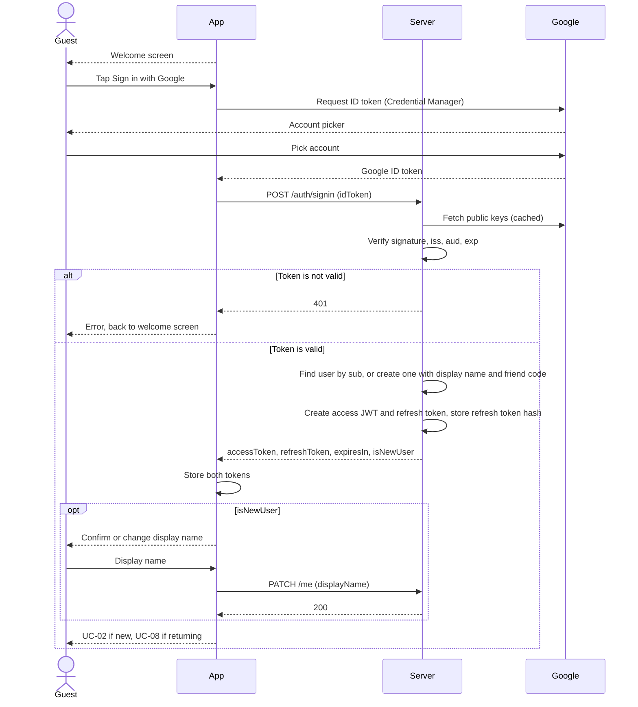
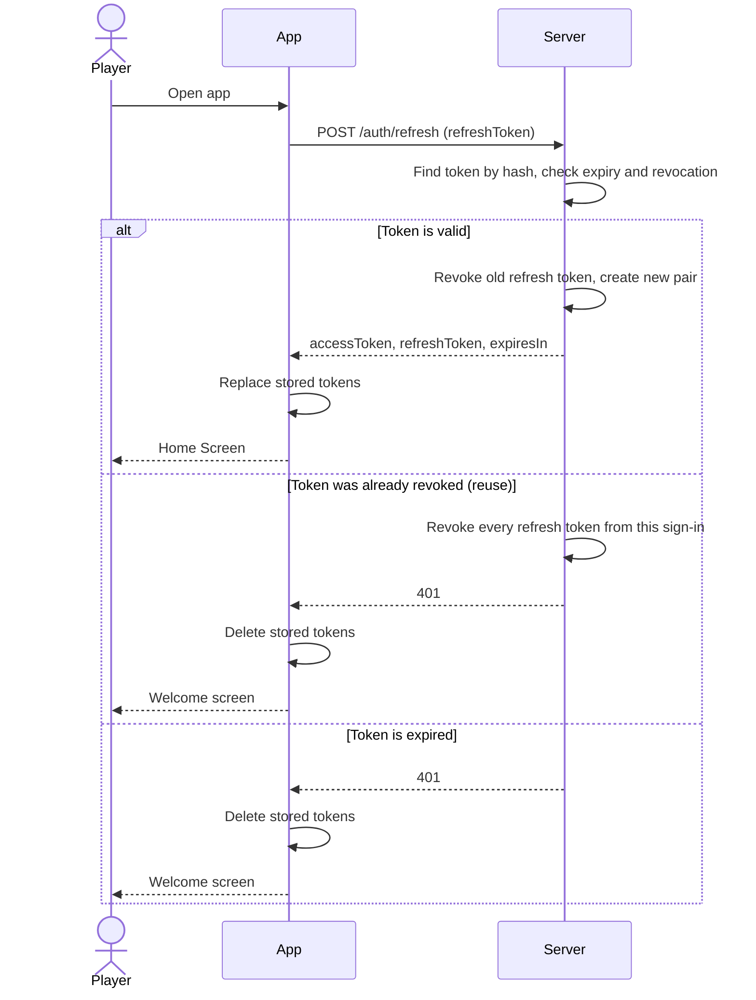
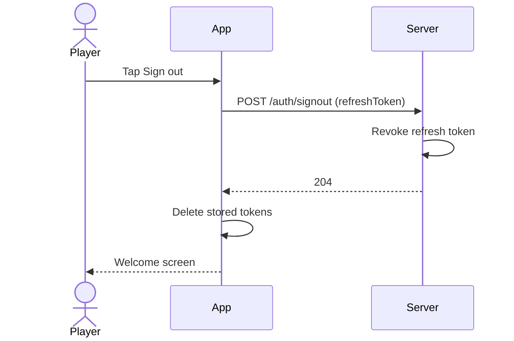

# UC-01: Sign Up / Sign In

| | |
|---|---|
| **Primary Actor** | Guest |
| **Supporting Actor** | Google (sign-in) |
| **Priority** | Must |

## Goal

The Guest signs in with their Google account so that the System can save their activity, Tomos and currency, and keep them across devices. The first sign-in also creates their account.

## Preconditions

- The app is installed and the device is online.
- The Guest has a Google account on the device.

## Trigger

The Guest opens the app.

## Main Flow

1. The System shows the welcome screen with a **Sign in with Google** option.
2. The Guest chooses **Sign in with Google**.
3. The Guest picks a Google account.
4. The System verifies the Guest's identity with Google.
5. The System finds the account linked to that Google account, or creates one if none exists.
6. The System signs the Player in.
7. If the account is new, the System shows the display name from the Google profile, and the Player confirms it or changes it.
8. A new Player goes to [UC-02 Choose Starter Tomo](UC-02-choose-starter-tomo.md). A returning Player goes to [UC-08 Home Screen](UC-08-view-home-screen.md).

## Alternate / Exception Flows

- **1a. The Player is still signed in from an earlier visit:** The System goes straight to the Home Screen. If that sign-in expired, the flow continues at step 1.
- **3a. The Guest closes the account picker:** The System stays on the welcome screen.
- **3b. The device has no Google account:** The System shows a message that RunTomo needs a Google account to sign in.
- **4a. The device is offline:** The System shows a "No connection" message with a retry button.
- **4b. Google cannot verify the Guest's identity:** The System shows an error and returns to step 1.
- **7a. The display name is invalid** (too short or too long): The System shows the rule and asks again. The MVP has no blocked-word check.

## Postconditions

- The Player has an account linked to their Google account and is signed in on the device.

## Business Rules

- BR-1: A display name is 3–20 characters. It does not need to be unique, because a separate friend code identifies the Player (see [UC-15](UC-15-add-friend.md)).
- BR-2: The System creates a unique friend code when it creates the account.
- BR-3: The System asks for permission to read steps from Health Connect only when it first needs it, in [UC-03](UC-03-sync-daily-activity.md), not at sign-up.
- BR-4: Google is the only sign-in method in the MVP.
- BR-5: The default display name is the name from the Google profile. If that name breaks BR-1, the System uses "Runner" plus 4 random digits.
- BR-6: The System links the account to the Google account itself, not to its email address. If the Player changes their Google email, they keep their RunTomo account.
- BR-7: A Player who opens the app at least once every 30 days stays signed in *(tunable)*.
- BR-8: Signing out signs the Player out on that device only.
- BR-9: A Guest cannot play before they sign in. There is no guest mode and no account linking later.

## Related

- [UC-02 Choose Starter Tomo](UC-02-choose-starter-tomo.md)

## Diagrams

### Sign in

### Reopen the app, or the access token expires

### Sign out

### Technical notes

- The server identifies the account by Google's subject ID (the `sub` claim), not the email address (BR-6).
- The server accepts only ID tokens whose audience (the `aud` claim) is RunTomo's web OAuth client ID, which the app passes as `serverClientId`. The issuer is `accounts.google.com` or `https://accounts.google.com`.
- The app sends the Google ID token only at sign-in. All later requests use the server's access token (a JWT).
- The access token lasts 15 minutes and the refresh token lasts 30 days *(tunable)*. Each refresh replaces the refresh token with a new 30-day one, which gives BR-7.
- The server stores only a hash of each refresh token.
- Every refresh token from one sign-in shares a family. The app deletes a token after it refreshes or signs out, so a revoked token that has not expired and is sent again counts as stolen, and the server revokes its whole family.
- After sign-out, the access token stays valid until it expires.
- `/auth/signin`, `/auth/refresh` and `/auth/signout` do not need an access token.
