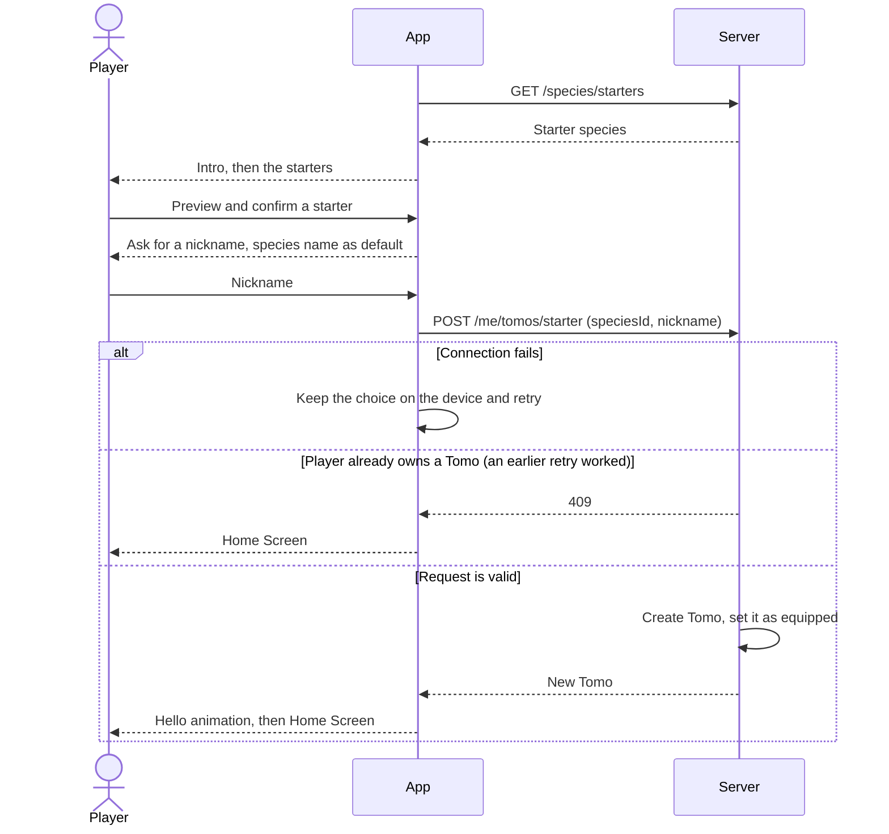

# UC-02: Choose Starter Tomo

| | |
|---|---|
| **Primary Actor** | Player |
| **Priority** | Must |

## Goal

A new Player gets their first Tomo, names it, and starts their journey together.

## Preconditions

- The Player has just created an account ([UC-01](UC-01-sign-up-sign-in.md)).
- The Player owns no Tomos.

## Trigger

The first sign-in finishes.

## Main Flow

1. The System shows a short intro, for example: "Every step is an adventure. Choose your companion."
2. The System shows the starter Tomos (for example 3 Common species).
3. The Player taps a starter to preview it (animation and short description).
4. The Player confirms their choice.
5. The System asks the Player to give the Tomo a nickname, with the species name as the default.
6. The Player enters a nickname, or keeps the default.
7. The System creates the Tomo with Bond Level 1, Distance Together 0 km and Birthday set to today.
8. The System makes it the Player's equipped Tomo.
9. The System plays a short "hello" animation and goes to the Home Screen ([UC-08](UC-08-view-home-screen.md)).

## Alternate / Exception Flows

- **4a. The Player does not confirm:** The flow returns to step 2.
- **6a. The nickname is invalid:** The System shows the rule and asks again.
- **7a. The connection drops:** The System keeps the choice and tries again. The Player cannot reach the Home Screen without a Tomo.

## Postconditions

- The Player owns exactly one Tomo, and it is equipped.

## Business Rules

- BR-1: Starter Tomos are a fixed set of Common species. Until more species exist, the starters are also the gacha pool ([UC-12](UC-12-summon-tomo.md)).
- BR-2: A nickname is 1–16 characters. Players can change it later ([UC-11](UC-11-manage-tomo-collection.md)).
- BR-3: The Tomo's Birthday is the date the Player got it.

## Related

- [UC-08 View Home Screen](UC-08-view-home-screen.md)
- [UC-11 Manage Tomo Collection](UC-11-manage-tomo-collection.md)

## Open Questions

- How many starters, and which species?
- Should starters stay in the gacha pool after more species exist?

## Diagrams

### Technical notes

- Starter species are the species marked as starters in the server's game data.
- The server creates the `user_tomos` row, then sets `users.equipped_tomo_id`, in one transaction.
- The server rejects a starter request from a Player who already owns a Tomo. A retry after a lost response therefore cannot create a second starter, and the app treats that `409` as success.
- The server checks the nickname length again (`user_tomos.nickname` allows 1–16 characters).
