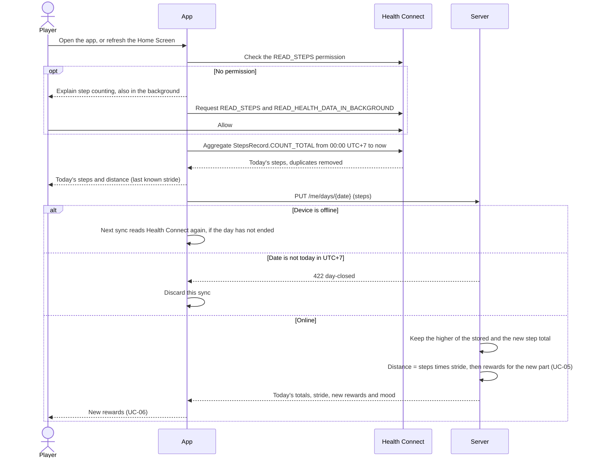
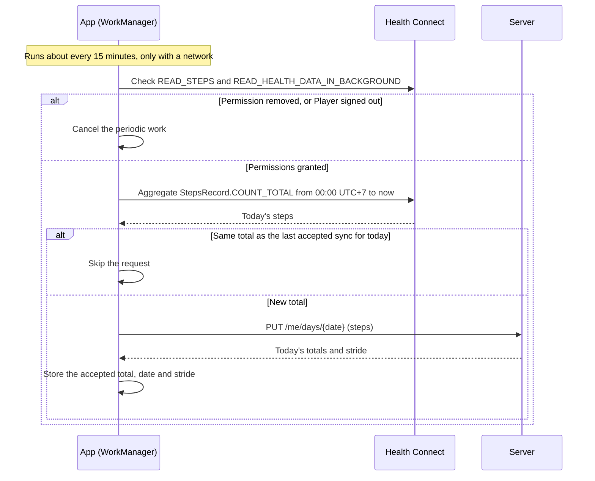

# UC-03: Sync Daily Activity

| | |
|---|---|
| **Primary Actor** | Player |
| **Supporting Actor** | Health Connect (step data) |
| **Priority** | Must |

## Goal

The System counts the Player's steps for today and turns them into distance. Every walk or run earns rewards, and the Player never has to start a session.

## Preconditions

- The Player is signed in and has an equipped Tomo.

## Trigger

One of these:

- The Home Screen loads ([UC-08](UC-08-view-home-screen.md)), or the Player refreshes it.
- The background sync runs (BR-7), while the app is closed.

## Main Flow

1. The System checks that it has permission to read steps from Health Connect.
2. The System reads the Player's total steps for today (BR-1).
3. The System calculates today's distance from the steps (BR-3).
4. If today's total is higher than the last synced total, the System calculates rewards for the new part ([UC-05](UC-05-calculate-daily-rewards.md)).
5. If the Home Screen is open, the System shows today's steps and distance, and any new rewards ([UC-06](UC-06-view-new-rewards.md)).

## Alternate / Exception Flows

- **1a. Permission to read steps is missing:** The System explains that RunTomo counts steps through Health Connect, also when the app is closed. Then it asks for permission to read steps and to read them in the background, in one request. If the Player refuses to let it read steps, the System shows a link to the Health Connect settings. The rest of the game still works, but no distance counts.
- **1b. Background reading is refused or not available:** The System counts steps only when the Player opens the app. The Home Screen shows a note about this, with a link to the Health Connect settings.
- **4a. The device is offline:** The System shows today's steps and distance from the phone. New rewards wait until the device is online again. If the day ends before that, the steps of that day do not count (BR-2).
- **4b. The new total is lower than the last synced total:** This can happen if the Player deleted data in Health Connect. The System keeps the higher total and takes no rewards back.
- **4c. The day ended before the sync arrived:** The System ignores the sync. The steps of that day do not count (BR-2).

## Postconditions

- The System has today's latest step total and distance for the Player.

## Business Rules

- BR-1: A day runs from 00:00 to 24:00 UTC+7 for every Player ([Days](README.md#days)).
- BR-2: Only today's steps earn rewards. Steps from earlier days do not count, even if the Player did not open the app that day. There is no grace period after midnight.
- BR-3: Distance = steps × 0.75 m *(tunable)*. The System uses the same stride for every Player. It does not use the distance that a watch or another app writes to Health Connect.
- BR-4: Steps from every source in Health Connect count: the phone, a watch or another fitness app. When two sources record the same steps, Health Connect counts them once.
- BR-5: The System does not check whether steps are real in the MVP.
- BR-6: Today's totals only go up. A sync never takes rewards back.
- BR-7: If the Player allows background reading, the System syncs about every 15 minutes while the app is closed. Android can delay a background sync, so steps late in the day can still miss the day (BR-2).

## Related

- [UC-05 Calculate Daily Rewards](UC-05-calculate-daily-rewards.md)
- [UC-06 View New Rewards](UC-06-view-new-rewards.md)
- [UC-08 View Home Screen](UC-08-view-home-screen.md)

## Open Questions

- What does the System do with a sync from a Player who has no equipped Tomo? Decide this with UC-05.

## Diagrams

### Foreground sync

### Background sync

### Technical notes

- The app reads steps with Health Connect's aggregate read (`StepsRecord.COUNT_TOTAL`) for today's range. The aggregate counts duplicate steps once, using the Player's app priority in Health Connect (BR-4).
- Permissions: `android.permission.health.READ_STEPS` and `android.permission.health.READ_HEALTH_DATA_IN_BACKGROUND`. The app requests both in one request. The Player can allow one and refuse the other.
- Before it schedules the worker, the app checks `HealthConnectFeatures.FEATURE_READ_HEALTH_DATA_IN_BACKGROUND`. If the feature is not available, the app syncs only in the foreground (1b).
- The app has `minSdk 36`, so Health Connect is always part of the platform and counts the phone's steps itself.
- The background sync is a unique periodic `WorkManager` job (15 minutes, `ExistingPeriodicWorkPolicy.KEEP`, `NetworkType.CONNECTED`). The app keeps no queue of failed syncs. Health Connect holds the steps, so the next run reads the total again.
- The app stores the last accepted total, its date and the stride in DataStore. It uses the stride to show distance while offline.
- The foreground sync and the worker use the same sync code. The app refreshes the access token in one place, with a lock, so two syncs never send the same refresh token ([UC-01](UC-01-sign-up-sign-in.md)).
- The app sends steps only. The server calculates distance with the stride from `game/tunables.yaml`, so the app cannot send its own distance.
- `PUT /me/days/{date}` with `{ "steps": n }` returns the stored row: `date`, `steps`, `distanceM` and `strideM`. The stored total can be higher than the one the app sent (4b).
- The server keeps the higher total in one upsert (`GREATEST`). The endpoint is safe to repeat, and two syncs at the same time are safe. The same total twice pays nothing new.
- The server accepts only today's date in UTC+7 (BR-2). Any other date, also a future one, returns `422` with the problem type `/problems/day-closed`. The app discards that sync and does not retry it. Other errors are retried on the next sync.
- The server returns `400` if `steps` is less than 0 or more than 100,000 *(tunable)*. This protects the stored values. It is not a check that steps are real (BR-5).
- Google Play asks apps that read Health Connect data to declare it and to have a privacy policy. Health Connect shows the permission screen only if the manifest declares the privacy policy activity (`ACTION_SHOW_PERMISSIONS_RATIONALE` and the `VIEW_PERMISSION_USAGE` activity-alias). The background read also needs a declaration in the Play Console.
