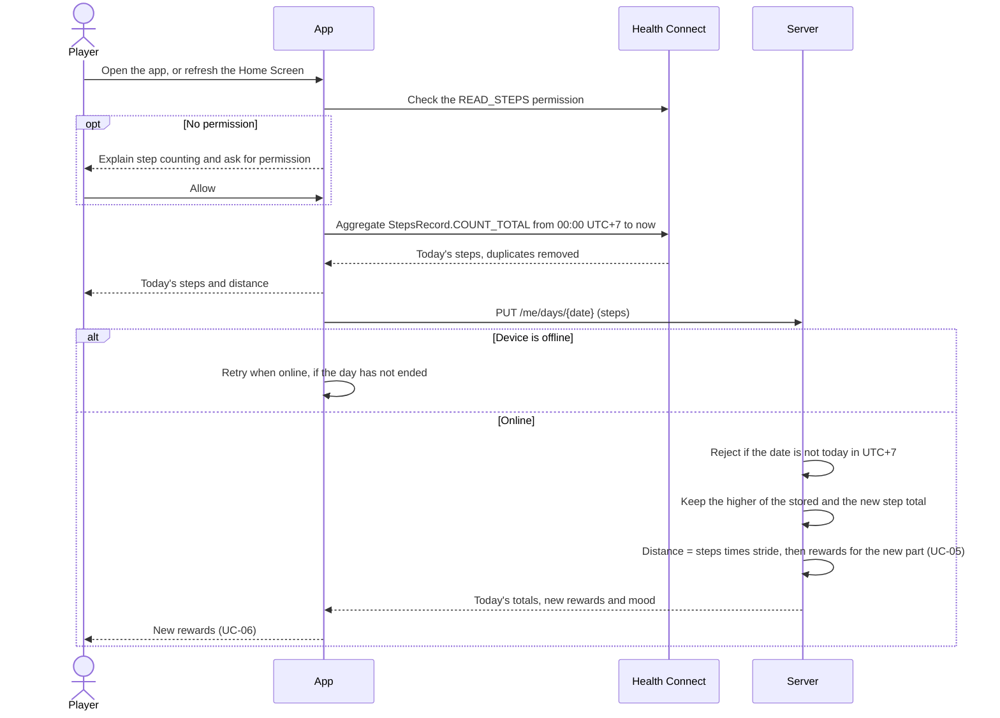

# UC-03: Sync Daily Activity

| | |
|---|---|
| **Primary Actor** | Player |
| **Supporting Actor** | Health Connect (step data) |
| **Priority** | Must |

## Goal

The System counts the Player's steps for today and turns them into distance. Every walk or run earns rewards, and the Player never has to start a session.

## Preconditions

- The Player is signed in and has an equipped Tomo.

## Trigger

The Home Screen loads ([UC-08](UC-08-view-home-screen.md)), or the Player refreshes it.

## Main Flow

1. The System checks that it has permission to read steps from Health Connect.
2. The System reads the Player's total steps for today (BR-1).
3. The System calculates today's distance from the steps (BR-3).
4. If today's total is higher than the last synced total, the System calculates rewards for the new part ([UC-05](UC-05-calculate-daily-rewards.md)).
5. The System shows today's steps and distance on the Home Screen, and any new rewards ([UC-06](UC-06-view-new-rewards.md)).

## Alternate / Exception Flows

- **1a. Permission is missing:** The System explains that RunTomo counts steps through Health Connect and asks for permission. If the Player refuses, the System shows a link to the Health Connect settings. The rest of the game still works, but no distance counts.
- **1b. Health Connect is not installed** (Android 13 and lower): The System links to Health Connect in the Play Store.
- **2a. No app writes steps to Health Connect** (Android 13 and lower): The System explains that the Player needs a fitness app that does.
- **4a. The device is offline:** The System shows today's steps and distance from the phone. New rewards wait until the device is online again.
- **4b. The new total is lower than the last synced total:** This can happen if the Player deleted data in Health Connect. The System keeps the higher total and takes no rewards back.

## Postconditions

- The System has today's latest step total and distance for the Player.

## Business Rules

- BR-1: A day runs from 00:00 to 24:00 UTC+7 for every Player ([Days](README.md#days)).
- BR-2: Only today's steps earn rewards. Steps from earlier days do not count, even if the Player did not open the app that day.
- BR-3: Distance = steps × 0.75 m *(tunable)*. The System uses the same stride for every Player.
- BR-4: Steps from every source in Health Connect count: the phone, a watch or another fitness app. When two sources record the same steps, Health Connect counts them once.
- BR-5: The System does not check whether steps are real in the MVP.
- BR-6: Today's totals only go up. A sync never takes rewards back.

## Related

- [UC-05 Calculate Daily Rewards](UC-05-calculate-daily-rewards.md)
- [UC-06 View New Rewards](UC-06-view-new-rewards.md)
- [UC-08 View Home Screen](UC-08-view-home-screen.md)

## Open Questions

- Should the app also sync in the background, so steps late in the day still count (BR-2)? Health Connect needs a separate background-read permission for this.
- Should a short grace period after midnight let the Player sync the day that just ended?
- Should the System use Health Connect's own distance when a watch or app records it? Runners have a longer stride, so BR-3 undercounts their distance.

## Diagrams

### Technical notes

- The app reads steps with Health Connect's aggregate read (`StepsRecord.COUNT_TOTAL`) for today's range. The aggregate counts duplicate steps once, using the Player's app priority in Health Connect (BR-4).
- The permission is `android.permission.health.READ_STEPS`. On Android 14 and higher, Health Connect counts the phone's steps itself once an app has this permission. On Android 13 and lower, another app must write steps (2a).
- The app sends steps only. The server calculates distance with the stride from server config, so the app cannot send its own distance.
- `PUT /me/days/{date}` is safe to repeat. The same total twice pays nothing new.
- The server accepts only today's date in UTC+7 (BR-2). A sync that waited offline past midnight is rejected.
- `GET /home` includes the stride, so the app can show distance while offline.
- Google Play asks apps that read Health Connect data to declare it and to have a privacy policy.
