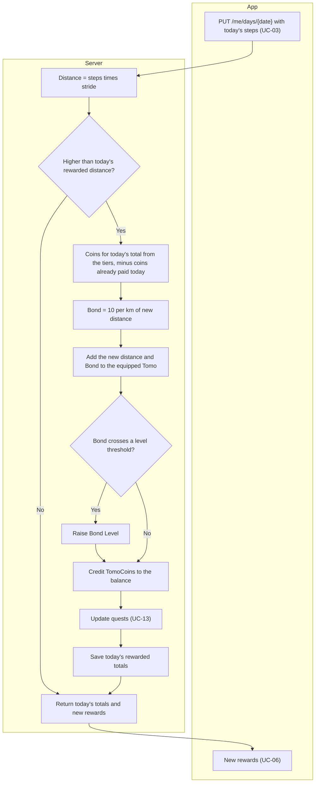

# UC-05: Calculate Daily Rewards

| | |
|---|---|
| **Primary Actor** | Player |
| **Priority** | Must |
| **Included in** | [UC-03 Sync Daily Activity](UC-03-sync-daily-activity.md) step 4 |

## Goal

Turn the new part of today's distance into TomoCoins and Bond for the equipped Tomo, and add it to that Tomo's Distance Together.

## Preconditions

- A sync brought a higher distance for today than the System already rewarded ([UC-03](UC-03-sync-daily-activity.md)).

## Trigger

A sync brings new distance for today.

## Main Flow

1. The System finds the new distance: today's distance minus the distance it already rewarded today.
2. The System calculates TomoCoins for today's total with the daily tiers (BR-1), then subtracts the coins it already paid today.
3. The System calculates Bond points from the new distance (BR-3).
4. The System adds the new distance to the equipped Tomo's **Distance Together**.
5. The System adds the Bond points to the equipped Tomo. If this crosses a threshold, the Tomo reaches the next Bond Level.
6. The System credits the TomoCoins to the Player's balance.
7. The System updates progress on daily quests ([UC-13](UC-13-complete-daily-quests.md)).
8. The System saves today's rewarded totals and shows the new rewards ([UC-06](UC-06-view-new-rewards.md)).

## Alternate / Exception Flows

- **2a. The Player is past the daily coin cap:** The new distance earns 0 TomoCoins, but Bond and Distance Together still increase.

## Postconditions

- The Player's TomoCoin balance, the Tomo's Bond and Distance Together, and quest progress are all updated.
- The System saved how much of today it rewarded, so the same steps never pay twice.

## Business Rules

- BR-1: TomoCoins per km for each day *(tunable)*:

  | Km today | TomoCoins per km |
  |---|---:|
  | 0–5 km | 100 |
  | 5–10 km | 50 |
  | over 10 km | 0 |

- BR-2: "Today" is the UTC+7 day ([UC-03](UC-03-sync-daily-activity.md) BR-1).
- BR-3: Bond: 10 Bond points per km, with no daily cap *(tunable)*.
- BR-4: Bond Levels go from 1 to 10. The gap between levels grows by 50 Bond at each level *(tunable)*:

  | Bond Level | Total Bond | ≈ km |
  |---:|---:|---:|
  | 1 | 0 | 0 |
  | 2 | 50 | 5 |
  | 3 | 150 | 15 |
  | 4 | 300 | 30 |
  | 5 | 500 | 50 |
  | 6 | 750 | 75 |
  | 7 | 1,050 | 105 |
  | 8 | 1,400 | 140 |
  | 9 | 1,800 | 180 |
  | 10 | 2,250 | 225 |

- BR-5: Bond never decreases in the MVP.
- BR-6: The Tomo that is equipped at the time of the sync gets the new Distance Together and Bond.
- BR-7: The System pays only for the part of today's distance above what it already rewarded. A repeated sync pays nothing new.

## Related

- [UC-03 Sync Daily Activity](UC-03-sync-daily-activity.md)
- [UC-06 View New Rewards](UC-06-view-new-rewards.md)
- [UC-13 Complete Daily Quests](UC-13-complete-daily-quests.md)

## Open Questions

- Is there a separate Player XP / Player Level in the MVP, or only Tomo Bond?

## Diagrams

### Technical notes

- All the steps run in one database transaction, inside the `PUT /me/days/{date}` request. The server first locks the Player's `daily_stats` row for today, so two syncs at once cannot both pay.
- `daily_stats` holds today's `steps`, `distance_m`, `activity_coins` (coins paid today) and `bond_points` (Bond paid today). New coins = tier coins for `distance_m` minus `activity_coins`.
- Coins go into `coin_transactions` with reason `activity` and a null `ref_id`, because one day can pay several times. The server updates `users.coin_balance` in the same transaction.
- The Tomo in `users.equipped_tomo_id` at sync time gets the new distance and Bond (BR-6). The server updates its `distance_together_m`, `bond_points` and `bond_level`.
