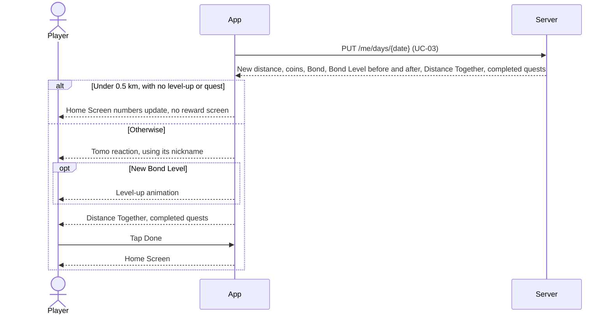

# UC-06: View New Rewards

| | |
|---|---|
| **Primary Actor** | Player |
| **Priority** | Must |

## Goal

After a sync, the Player sees what their steps earned and how their Tomo reacted. This is the main reward moment of the loop.

## Preconditions

- A sync brought new distance for today ([UC-03](UC-03-sync-daily-activity.md), [UC-05](UC-05-calculate-daily-rewards.md)).

## Trigger

A sync finishes with new rewards.

## Main Flow

1. The System shows the equipped Tomo's reaction, for example:
   > **Mochi walked 1.2 km with you!**
   > +12 Bond · +120 TomoCoins
2. If the Tomo reached a new Bond Level, the System plays a level-up animation.
3. The System shows the new Distance Together total.
4. The System shows any quests that this sync completed.
5. The Player taps **Done** and returns to the Home Screen.

## Alternate / Exception Flows

- **1a. The new distance is less than 0.5 km** (BR-2): The System updates the numbers on the Home Screen and shows no reward screen.
- **1b. The Player is past the daily coin cap:** The reaction shows the Bond only, with a note that today's TomoCoin limit is reached.
- **3a. The Tomo reached a Distance Together milestone** (for example 10, 42.195, 100 km): The System shows a special milestone message.

## Postconditions

- None. This use case only shows information.

## Business Rules

- BR-1: The Tomo's reaction message mentions the Tomo by nickname.
- BR-2: The System shows the reward screen only when the new distance is at least 0.5 km *(tunable)*. A level-up or a completed quest always shows it.

## Related

- [UC-03 Sync Daily Activity](UC-03-sync-daily-activity.md)
- [UC-05 Calculate Daily Rewards](UC-05-calculate-daily-rewards.md)
- [UC-08 View Home Screen](UC-08-view-home-screen.md)

## Open Questions

- Should the Player be able to share the reward screen as an image in the MVP?

## Diagrams

### Technical notes

- The `PUT /me/days/{date}` response carries everything this screen needs, so it needs no extra request.
- The response includes the Bond Level before and after, so the app knows when to show step 2.
- The app shows each reward screen once. Daily history ([UC-07](UC-07-view-daily-history.md)) shows each day's totals instead.
