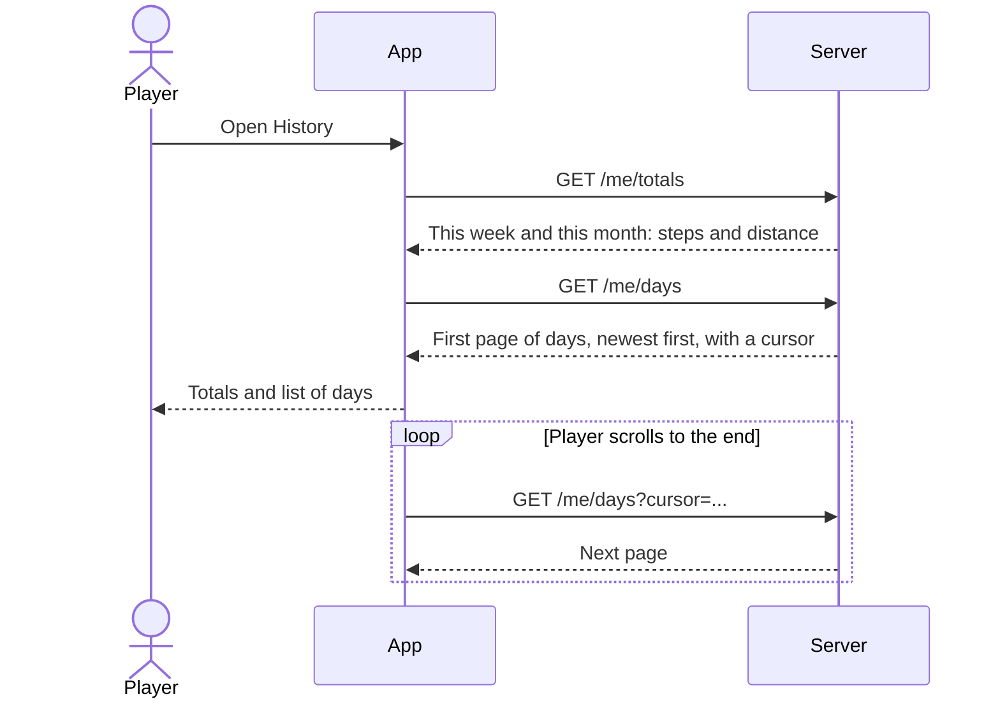

# UC-07: View Daily History

| | |
|---|---|
| **Primary Actor** | Player |
| **Priority** | Must |

## Goal

The Player looks back at their daily steps and distance, so RunTomo works as a real fitness tracker.

## Preconditions

- The Player is signed in.

## Trigger

The Player opens **History**.

## Main Flow

1. The System shows totals for this week and this month: steps and distance.
2. The System shows a list of days, newest first. Each day shows the date, steps, distance, and the TomoCoins and Bond it earned.
3. The Player scrolls. The System loads older days as needed.

## Alternate / Exception Flows

- **2a. No synced days yet:** The System shows an empty state with the Tomo and a short message, for example "Let's go for a walk!".
- **2b. Today is not synced yet (the device is offline):** The System shows today's steps from the phone, marked "Waiting to sync".

## Postconditions

- None. This use case only shows information.

## Business Rules

- BR-1: History shows the totals the System received for each day. Steps after a day's last sync do not appear ([UC-03](UC-03-sync-daily-activity.md) BR-2).
- BR-2: Weeks run Monday to Sunday, and months run by calendar month, in UTC+7.

## Related

- [UC-03 Sync Daily Activity](UC-03-sync-daily-activity.md)
- [UC-05 Calculate Daily Rewards](UC-05-calculate-daily-rewards.md)

## Open Questions

- Should history also show past days from Health Connect, including days the Player did not sync? Those days would show steps but no rewards.

## Diagrams

### Technical notes

- Totals are sums of `daily_stats.steps` and `distance_m` over the period.
- The list pages with a cursor on `local_date`, which matches the `daily_stats` primary key (`user_id`, `local_date`).
- A day with no sync has no `daily_stats` row, so it does not appear.
- "Waiting to sync" comes from the app, not from the server.
