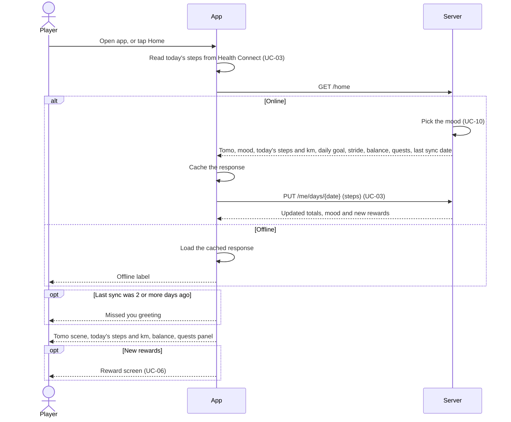

# UC-08: View Home Screen

| | |
|---|---|
| **Primary Actor** | Player |
| **Priority** | Must |

## Goal

The Player sees their Tomo and today's progress at a glance.

## Preconditions

- The Player is signed in and has an equipped Tomo.

## Trigger

The Player opens the app, or taps the **Home** tab.

## Main Flow

1. The System syncs today's steps ([UC-03](UC-03-sync-daily-activity.md)).
2. The System shows the equipped Tomo in its home scene, with an animation that matches its current mood ([UC-10](UC-10-update-tomo-mood.md)).
3. The System shows:
   - the Tomo's nickname, mood and Bond Level
   - today's steps, and today's distance against the daily goal (for example **2.8 / 5 km**)
   - the TomoCoin balance
   - a short daily-quests panel ([UC-13](UC-13-complete-daily-quests.md))
4. If the sync brought new rewards, the System shows them ([UC-06](UC-06-view-new-rewards.md)).
5. The Player can:
   - tap the Tomo → [UC-09 Interact With Tomo](UC-09-interact-with-tomo.md)
   - tap the quests panel → [UC-13](UC-13-complete-daily-quests.md)
   - tap **Feed** → [UC-18 Feed Tomo](UC-18-feed-tomo.md)

## Alternate / Exception Flows

- **1a. The device is offline:** The System shows today's steps from the phone and the last known values for the rest, with an "Offline" label.
- **2a. The Player's last sync was 2 or more days ago:** The Tomo greets them with a "missed you" message, for example "Mochi missed you!". Then the System shows the normal screen. There is no penalty.

## Postconditions

- None. This use case only shows information.

## Business Rules

- BR-1: The daily goal is the full-reward coin tier (5 km, [UC-05](UC-05-calculate-daily-rewards.md) BR-1) *(tunable)*.
- BR-2 (copy guideline, not testable): Messages and animations never make the Player feel guilty or punished.

## Related

- [UC-03 Sync Daily Activity](UC-03-sync-daily-activity.md)
- [UC-06 View New Rewards](UC-06-view-new-rewards.md)
- [UC-09 Interact With Tomo](UC-09-interact-with-tomo.md)
- [UC-10 Update Tomo Mood](UC-10-update-tomo-mood.md)

## Open Questions

- Should the Player be able to set their own daily goal?

## Diagrams

### Technical notes

- `GET /home` returns everything the screen needs. The sync itself is a separate `PUT /me/days/{date}` request ([UC-03](UC-03-sync-daily-activity.md)).
- The app calls `GET /home` before the sync, so "last sync date" still shows the previous sync for 2a.
- Today's distance is `daily_stats.distance_m` for today's UTC+7 date. The last sync date is the Player's newest `daily_stats.local_date`.
- The daily goal and the stride come from server config, not from the app.
- The app caches the last `GET /home` response for 1a.
