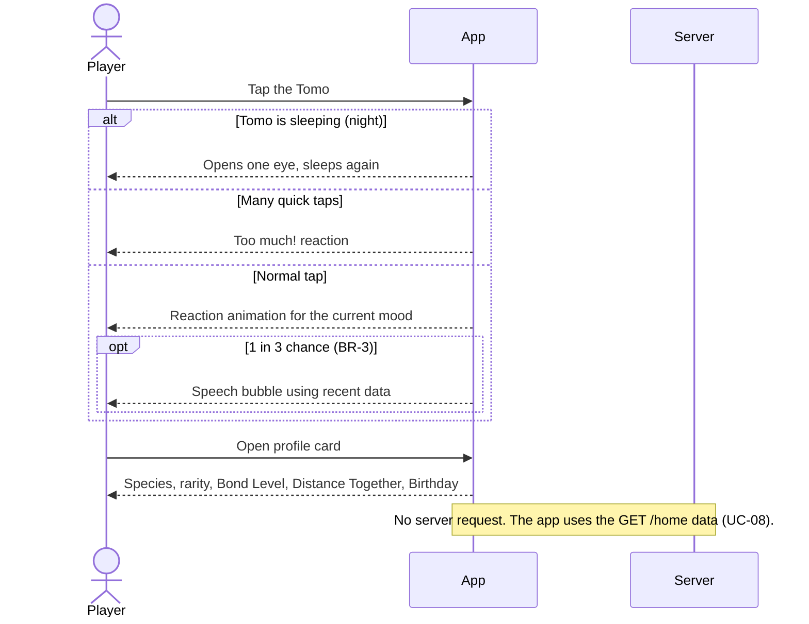

# UC-09: Interact With Tomo

| | |
|---|---|
| **Primary Actor** | Player |
| **Priority** | Must |

## Goal

The Player plays with their Tomo for a moment, so it feels alive and personal.

## Preconditions

- The Player is on the Home Screen with an equipped Tomo.

## Trigger

The Player taps or strokes the Tomo.

## Main Flow

1. The Player taps the Tomo.
2. The System plays a reaction animation that fits the current mood (for example a happy hop, a wag or a purr).
3. On some taps, the System shows a short speech bubble (BR-3), for example "Let's go for a walk!" or "That was fun yesterday!".
4. The Player can open the Tomo's profile card, which shows species, rarity, Bond Level, Distance Together and Birthday.

## Alternate / Exception Flows

- **2a. The Tomo is sleeping (at night):** It opens one eye, then sleeps again.
- **2b. The Player taps many times quickly:** The Tomo plays a playful "too much!" reaction.

## Postconditions

- None in the MVP. Tapping does not change Bond.

## Business Rules

- BR-1: Tapping gives no Bond. Moving is the main way to earn Bond, and feeding ([UC-18](UC-18-feed-tomo.md)) adds only a capped amount. See `RunTomo_Idea.md` §46.1.
- BR-2: Speech bubbles can mention the Player's real data, such as today's steps.
- BR-3: A normal tap has a 1 in 3 chance of showing a speech bubble *(tunable)*.

## Related

- [UC-08 View Home Screen](UC-08-view-home-screen.md)
- [UC-10 Update Tomo Mood](UC-10-update-tomo-mood.md)

## Open Questions

- Should a small, capped amount of Bond per day come from interaction?

## Diagrams

### Technical notes

- This all runs in the app. The mood, today's totals and Tomo details come from the `GET /home` response.
- Tapping sends nothing to the server, because it changes no data (BR-1).
