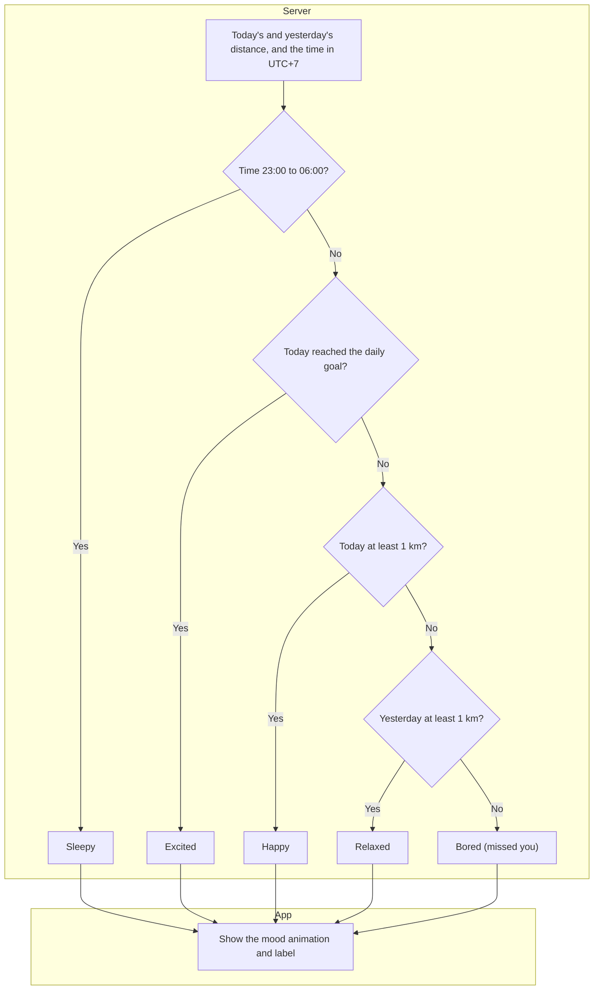

# UC-10: Update Tomo Mood

| | |
|---|---|
| **Primary Actor** | Player |
| **Priority** | Must |
| **Included in** | [UC-03 Sync Daily Activity](UC-03-sync-daily-activity.md), [UC-08 View Home Screen](UC-08-view-home-screen.md), [UC-18 Feed Tomo](UC-18-feed-tomo.md) |

## Goal

Set each Tomo's mood from the Player's recent activity and the time of day, so the Tomo encourages healthy habits without punishing the Player.

## Preconditions

- The Player owns at least one Tomo.

## Trigger

One of these happens:

- The Home Screen loads.
- A sync brings new distance ([UC-03](UC-03-sync-daily-activity.md)).
- The Player feeds a Tomo ([UC-18](UC-18-feed-tomo.md), if built).

## Main Flow

1. The System reads the Player's distance for today and yesterday, and the current time in UTC+7.
2. The System picks a mood using the rules in BR-1.
3. The System shows the animation and label for that mood.

## Alternate / Exception Flows

- None.

## Postconditions

- The equipped Tomo shows its current mood.

## Business Rules

- BR-1: The System checks the mood rules in this order *(tunable)*:

  | Condition | Mood |
  |---|---|
  | The time is 23:00–06:00 UTC+7 | Sleepy |
  | Today's distance reached the daily goal ([UC-08](UC-08-view-home-screen.md) BR-1) | Excited |
  | Today's distance is at least 1 km | Happy |
  | Yesterday's distance was at least 1 km | Relaxed |
  | None of the above | Bored ("missed you") |

- BR-2: The System picks the mood from data each time it needs it. Mood is not a value that drains over time.
- BR-3: Mood never lowers Bond and never blocks any feature.

## Related

- [UC-08 View Home Screen](UC-08-view-home-screen.md)
- [UC-09 Interact With Tomo](UC-09-interact-with-tomo.md)

## Open Questions

- Should moods also depend on each species' personality later?
- What mood does a brand-new Tomo have? BR-1 makes it Bored until the Player walks 1 km.

## Diagrams

### Technical notes

- The server picks the mood whenever it builds a response that shows the Tomo: `GET /home`, `PUT /me/days/{date}` and feeding. As the ERD notes, the server does not store the mood (BR-2).
- Today's and yesterday's distance come from `daily_stats.distance_m`. A day with no row counts as 0 km.
