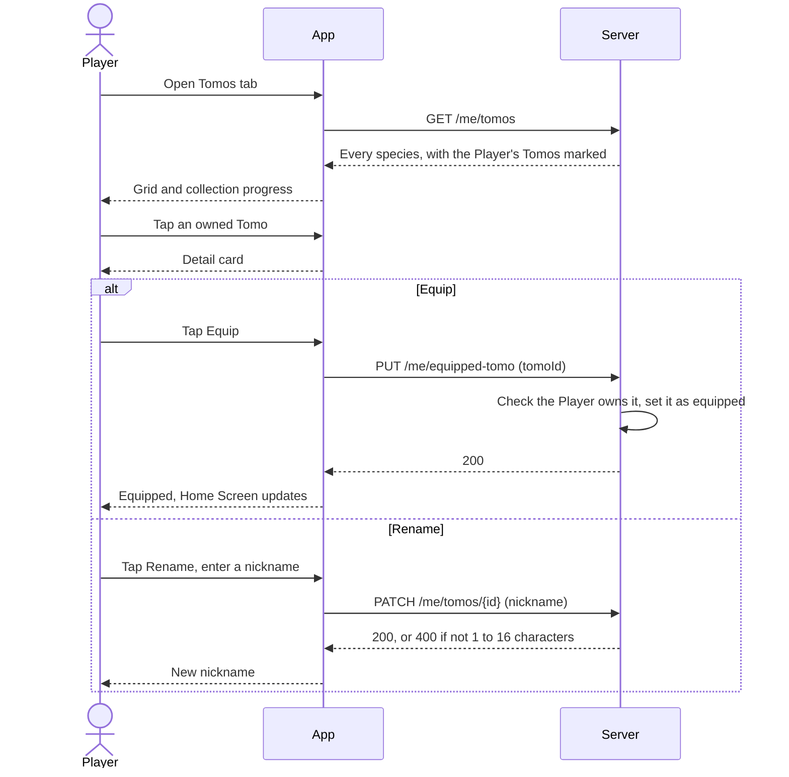

# UC-11: Manage Tomo Collection

| | |
|---|---|
| **Primary Actor** | Player |
| **Priority** | Must |

## Goal

The Player browses the Tomos they own, chooses which one to walk with, and can rename them.

## Preconditions

- The Player is signed in.

## Trigger

The Player opens the **Tomos** tab.

## Main Flow

1. The System shows a grid of every species in the MVP roster. Owned Tomos show their art. Species not owned yet show a silhouette.
2. The System shows collection progress, for example **4 / 10 collected**.
3. The Player taps an owned Tomo.
4. The System shows its detail card: art, nickname, species, rarity, Bond Level, Distance Together and Birthday.
5. The Player taps **Equip**.
6. The System makes it the equipped Tomo, and the Home Screen updates.

## Alternate / Exception Flows

- **1a. Sort / filter:** The Player can sort by rarity, Bond or Distance Together.
- **3a. The Player taps a silhouette:** The System shows the species name and rarity, with a hint to summon it ([UC-12](UC-12-summon-tomo.md)).
- **5a. The Player taps Rename:** The Player enters a new nickname (1–16 characters), and the System saves it.

## Postconditions

- The chosen Tomo is equipped, or the Tomo has its new nickname.

## Business Rules

- BR-1: Exactly one Tomo is equipped at any time.
- BR-2: Each Tomo keeps its own Bond and Distance Together. Switching Tomos does not move progress from one to another.

## Related

- [UC-02 Choose Starter Tomo](UC-02-choose-starter-tomo.md)
- [UC-12 Summon Tomo](UC-12-summon-tomo.md)

## Open Questions

- Can a Player own more than one Tomo of the same species, or do duplicates always convert ([UC-12](UC-12-summon-tomo.md) BR-4)?

## Diagrams

### Technical notes

- The roster is every row in `species`. The response marks which species the Player owns.
- `users.equipped_tomo_id` has a foreign key to `user_tomos (id, user_id)`, so the database refuses a Tomo the Player does not own.
- The newly equipped Tomo gets Bond and Distance Together from the next sync onward ([UC-05](UC-05-calculate-daily-rewards.md) BR-6).
- Species and skins are in separate tables (`species`, `skins`, `user_tomos.skin_id`), so a later version can add skins. The MVP uses only each species' default skin.
