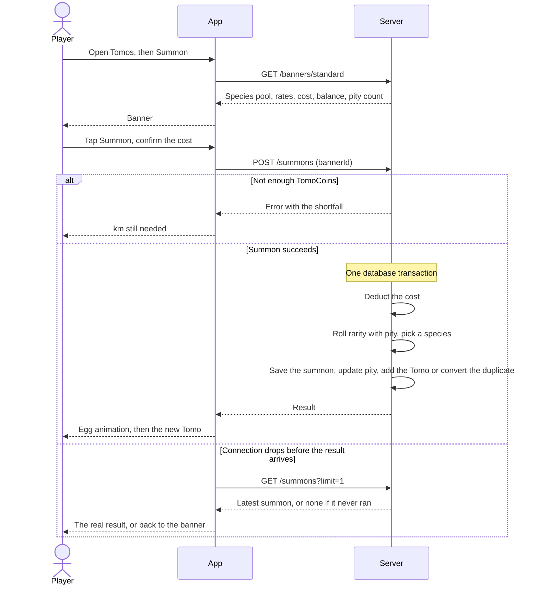

# UC-12: Summon Tomo (Gacha)

| | |
|---|---|
| **Primary Actor** | Player |
| **Priority** | Must |

## Goal

The Player spends TomoCoins earned by moving to hatch an egg and get a new Tomo.

## Preconditions

- The Player is signed in.
- The device is online.

## Trigger

The Player opens **Tomos → Summon**.

## Main Flow

1. The System shows the standard banner with:
   - the species in the pool
   - the rarity rates
   - the cost per summon
   - the Player's TomoCoin balance
   - the pity counter (for example "Epic or higher guaranteed in 7 summons")
2. The Player taps **Summon**.
3. The System asks the Player to confirm the cost.
4. The System checks the balance and deducts the cost.
5. The System rolls the rarity, applying pity (BR-3), then picks a species of that rarity.
6. The System saves the result and updates the pity counter.
7. The System plays the egg animation: the equipped Tomo watches the egg, the egg shakes and cracks, and the background glows in the rarity's color.
8. The new Tomo appears with its name and rarity.
9. The Player can give it a nickname, or **Equip** it now.

## Alternate / Exception Flows

- **4a. Not enough TomoCoins:** The System shows how many more km the Player needs, for example "Walk about 3.2 km more to summon".
- **5a. The result is a species the Player already owns:** The System shows the duplicate and converts it under BR-4.
- **6a. The connection drops during the summon:** The System shows the real result once the connection returns. The Player never loses TomoCoins without getting a result.

## Postconditions

- The cost is deducted, and the Player owns the new Tomo or received the duplicate conversion.
- The System keeps a record of the summon for auditing and pity.

## Business Rules

- BR-1: The cost is 1,000 TomoCoins per summon, about 10 km *(tunable)*.
- BR-2: Rarity rates for the MVP *(tunable)*:

  | Rarity | Rate |
  |---|---:|
  | Common | 50% |
  | Uncommon | 28% |
  | Rare | 15% |
  | Epic | 6% |
  | Legendary | 1% |

- BR-3: Pity: if the last 19 summons gave nothing Epic or higher, the 20th is Epic or higher. The counter resets whenever a summon gives Epic or higher *(tunable)*.
- BR-4: The System converts a duplicate into 200 TomoCoins *(tunable)*. Species Shards come later.
- BR-5: The rates that the System shows the Player are exactly the rates it uses.
- BR-6: Players cannot buy summons with real money in the MVP.
- BR-7: A summon either finishes completely (coins spent and result received) or not at all.

## Related

- [UC-05 Calculate Daily Rewards](UC-05-calculate-daily-rewards.md)
- [UC-11 Manage Tomo Collection](UC-11-manage-tomo-collection.md)

## Open Questions

- What is the MVP roster: 8–10 species, and how many at each rarity?
- Should there be a 10-summon option?
- Should the first summon always give Rare or higher, as an onboarding hook?

## Diagrams

### Technical notes

- Summons run only on the server. The server uses a secure random number generator for the roll.
- The banner, rates and pool come from `banners`, `banner_rates` and `banner_species`. The app shows the rates it gets from the server and never has rates built in (BR-5).
- One database transaction covers all of these (BR-7):
  - deducting the cost
  - saving the `summons` row
  - updating `user_pity.pulls_since_epic`
  - creating the `user_tomos` row, or crediting the duplicate coins
- Coin changes are `coin_transactions` rows with reason `summon` (the cost) or `duplicate` (the refund), with `ref_id` = the summon.
- After a lost response (6a), the app reads the latest summon instead of sending a new one, so it never charges twice.
