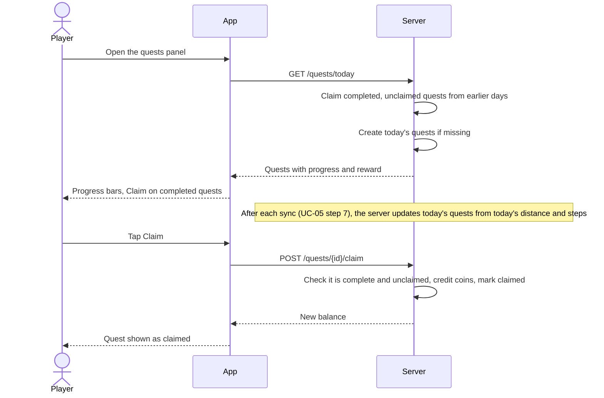

# UC-13: Complete Daily Quests

| | |
|---|---|
| **Primary Actor** | Player |
| **Priority** | Must |

## Goal

The Player completes small daily goals for extra TomoCoins, which gives them a reason to move every day.

## Preconditions

- The Player is signed in.

## Trigger

One of these happens:

- The Player opens the quests panel.
- A sync brings new distance or steps ([UC-05](UC-05-calculate-daily-rewards.md) step 7).

## Main Flow

1. Each day at midnight UTC+7, the System gives the Player 3 new quests.
2. The System shows each quest with a progress bar and its reward.
3. After each sync, the System updates the progress of each quest.
4. When a quest is complete, the System shows a **Claim** button on it.
5. The Player taps **Claim**.
6. The System credits the reward and marks the quest as claimed.

## Alternate / Exception Flows

- **4a. The day ends with completed quests not yet claimed:** The System claims them automatically, so the Player never loses a reward they earned.

## Postconditions

- Quest progress is up to date, and the balance includes the claimed rewards.

## Business Rules

- BR-1: MVP quest list *(tunable)*:

  | Quest | Reward |
  |---|---:|
  | Walk or run 1 km | 100 TomoCoins |
  | Walk or run 3 km | 200 TomoCoins |
  | Take 5,000 steps | 150 TomoCoins |

- BR-2: Quest rewards do **not** count toward the daily coin cap in [UC-05](UC-05-calculate-daily-rewards.md).
- BR-3: Quests reset at midnight UTC+7.

## Related

- [UC-05 Calculate Daily Rewards](UC-05-calculate-daily-rewards.md)
- [UC-08 View Home Screen](UC-08-view-home-screen.md)

## Open Questions

- Should the quests be the same every day, or drawn from a pool?
- Should there be a bonus for completing all 3?

## Diagrams

### Technical notes

- Quest types are rows in `quest_definitions` (`metric` is `distance_m` or `steps`). Each day's quests are rows in `user_daily_quests` for the UTC+7 `local_date`.
- The server creates a day's rows the first time it needs them that day, when the Player opens the app or syncs. The server needs no midnight job. At the same moment it claims any completed, unclaimed quests from earlier days (4a).
- Claiming adds a `coin_transactions` row with reason `quest` and `ref_id` = the `user_daily_quests` row, so a quest can never pay twice. Quest coins are not added to `daily_stats.activity_coins` (BR-2).
- Progress is today's `distance_m` or `steps` from `daily_stats`, so it always matches the day's totals.
