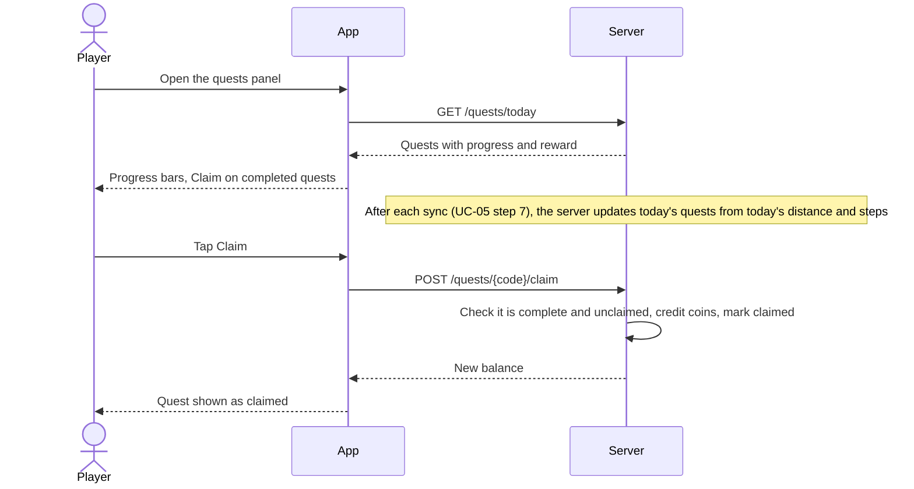

# UC-13: Complete Daily Quests

| | |
|---|---|
| **Primary Actor** | Player |
| **Priority** | Must |

## Goal

The Player completes small daily goals for extra TomoCoins, which gives them a reason to move every day.

## Preconditions

- The Player is signed in.

## Trigger

One of these happens:

- The Player opens the quests panel.
- A sync brings new distance or steps ([UC-05](UC-05-calculate-daily-rewards.md) step 7).

## Main Flow

1. Every Player has the same 3 quests every day (BR-1).
2. The System shows each quest with a progress bar and its reward.
3. After each sync, the System updates the progress of each quest.
4. When a quest is complete, the System shows a **Claim** button on it.
5. The Player taps **Claim**.
6. The System credits the reward and marks the quest as claimed.

## Alternate / Exception Flows

- **4a. The day ends with completed quests not yet claimed:** The quests reset, and the Player does not get those rewards. The Player must claim each reward on the day they complete the quest.

## Postconditions

- Quest progress is up to date, and the balance includes the claimed rewards.

## Business Rules

- BR-1: MVP quest list, the same for every Player every day *(tunable)*:

  | Quest | Reward |
  |---|---:|
  | Walk or run 1 km | 100 TomoCoins |
  | Walk or run 3 km | 200 TomoCoins |
  | Take 5,000 steps | 150 TomoCoins |

- BR-2: Quest rewards do **not** count toward the daily coin cap in [UC-05](UC-05-calculate-daily-rewards.md).
- BR-3: Quests reset at midnight UTC+7.

## Related

- [UC-05 Calculate Daily Rewards](UC-05-calculate-daily-rewards.md)
- [UC-08 View Home Screen](UC-08-view-home-screen.md)

## Open Questions

- Should there be a bonus for completing all 3?

## Diagrams

### Technical notes

- The quest list (code, title, metric `distance_m` or `steps`, target, reward) is hard-coded in server config, not stored in the database.
- Progress is not stored. It is today's `distance_m` or `steps` from `daily_stats`, so it always matches the day's totals.
- A claim is a `quest_claims` row (`user_id`, `quest_code`, `local_date`). That key is unique, so a quest pays once per day. `POST /quests/{code}/claim` claims for today.
- The server needs no midnight job. Progress comes from today's `daily_stats` row, so the quests reset when the UTC+7 date changes. Only the Player's claim pays a reward (4a).
- Claiming adds a `coin_transactions` row with reason `quest` and `ref_id` = the `quest_claims` row. Quest coins are not added to `daily_stats.activity_coins` (BR-2).
