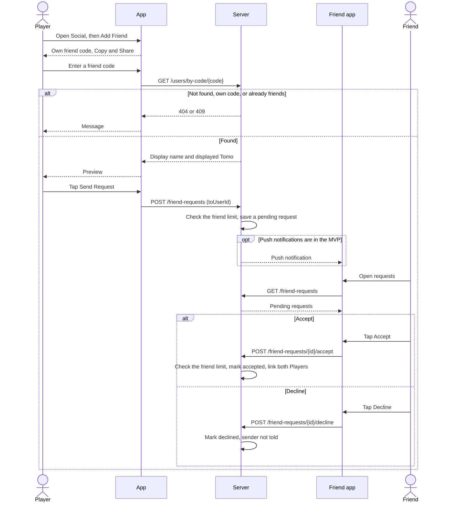

# UC-15: Add Friend

| | |
|---|---|
| **Primary Actor** | Player |
| **Priority** | Should |

## Goal

The Player connects with people they know so they can compare activity and motivate each other.

## Preconditions

- The Player is signed in and online.

## Trigger

The Player opens **Social → Add Friend**.

## Main Flow

1. The System shows the Player's own friend code, with **Copy** and **Share** buttons.
2. The Player enters a friend's code.
3. The System shows that Player's display name and displayed Tomo.
4. The Player taps **Send Request**.
5. The System sends the request to the other Player.
6. The other Player opens their requests and taps **Accept**.
7. The System links both Players as friends.

## Alternate / Exception Flows

- **3a. No Player has this code:** The System shows "No player with this code".
- **3b. It is the Player's own code, or they are already friends:** The System shows a message and stops.
- **6a. The other Player declines:** The System discards the request and does not tell the sender.
- **Remove friend:** From a friend's profile the Player taps **Remove**. The System removes the link for both Players and notifies neither.

## Postconditions

- Both Players see each other in their friends lists.

## Business Rules

- BR-1: A Player can have at most 100 friends *(tunable)*.
- BR-2: Friends can see only:
  - display name
  - displayed Tomo
  - distance for today, this week and this month

  The System shares no location or routes in the MVP.
- BR-3: Players cannot search for each other by name, which protects privacy. Friend codes or invite links are the only way to connect.

## Related

- [UC-16 View Friend Leaderboard](UC-16-view-friend-leaderboard.md)

## Open Questions

- Should invite links (deep links) be part of the MVP, or only codes?
- Are push notifications part of the MVP?

## Diagrams

### Technical notes

- Friend codes are `users.friend_code`, which is unique and created at sign-up ([UC-01](UC-01-sign-up-sign-in.md) BR-2).
- Requests are `friend_requests` rows with status `pending`, `accepted` or `declined`. Each pair can have only one pending request. The server keeps a declined request, but the sender never sees its status.
- A friendship is one `friendships` row per pair, with the smaller user ID in `user_a_id`. Queries must check both columns.
- The server checks the 100-friend limit (BR-1) when a Player sends a request, and again when the other Player accepts it.
- Removing a friend: `DELETE /friends/{userId}` deletes the `friendships` row.
- Without push notifications, the other Player sees the request the next time they open their requests.
