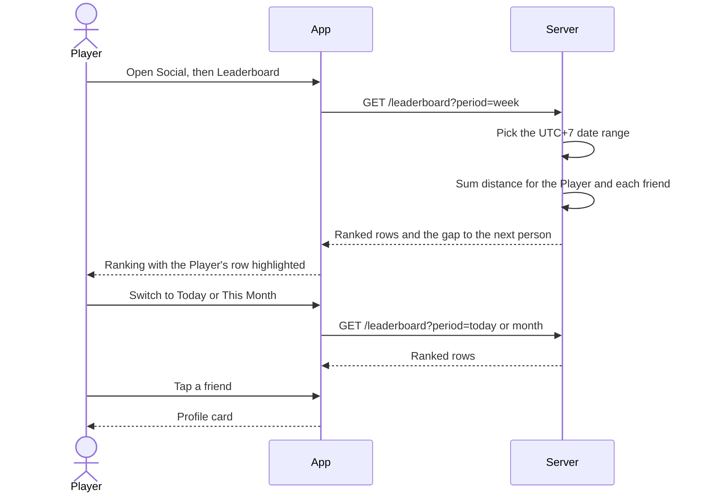

# UC-16: View Friend Leaderboard

| | |
|---|---|
| **Primary Actor** | Player |
| **Priority** | Should |

## Goal

The Player compares their weekly distance with their friends. This is friendly competition at a scale that motivates.

## Preconditions

- The Player is signed in and has at least one friend ([UC-15](UC-15-add-friend.md)).

## Trigger

The Player opens **Social → Leaderboard**.

## Main Flow

1. The System shows this week's ranking of the Player and their friends by distance.
2. Each row shows the rank, display name, displayed Tomo and km this week.
3. The System highlights the Player's own row, with the gap to the next person, for example "1.8 km behind Alex".
4. The Player can switch between **Today**, **This Week** and **This Month**.
5. The Player can tap a friend to see their profile card.

## Alternate / Exception Flows

- **1a. The Player has no friends:** The System shows an empty state with an **Add Friend** button ([UC-15](UC-15-add-friend.md)).

## Postconditions

- None. This use case only shows information.

## Business Rules

- BR-1: Rankings use each Player's synced daily distance ([UC-03](UC-03-sync-daily-activity.md) BR-2).
- BR-2: The week runs Monday 00:00 to Sunday 23:59 UTC+7.
- BR-3: There is no global leaderboard in the MVP.

## Related

- [UC-15 Add Friend](UC-15-add-friend.md)
- [UC-03 Sync Daily Activity](UC-03-sync-daily-activity.md)

## Decisions

- The top friend each week gets no reward or badge in the MVP.

## Diagrams

### Technical notes

- Distance is the sum of `daily_stats.distance_m` over the date range.
- Every Player's days are UTC+7, so one date range fits the Player and all friends.
- Friends come from `friendships`, checking both `user_a_id` and `user_b_id`.
- The response includes only the fields in [UC-15](UC-15-add-friend.md) BR-2.
