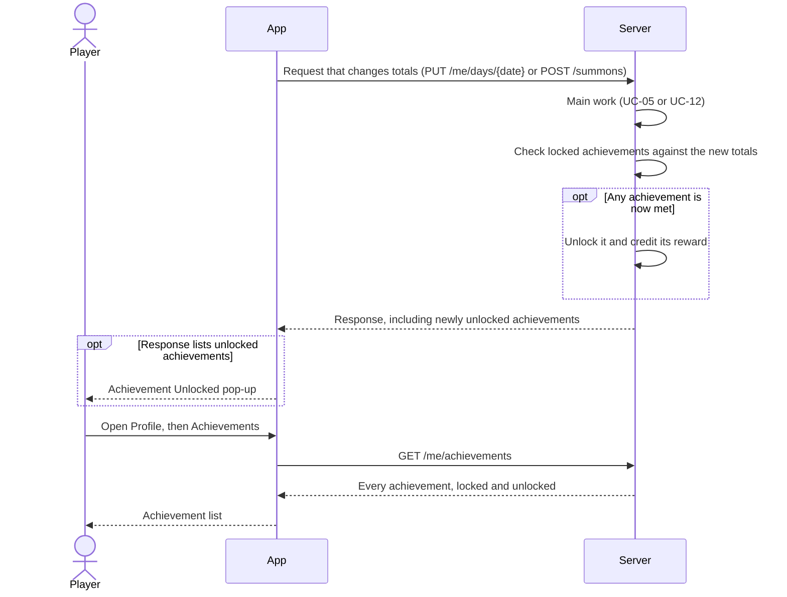

# UC-17: Unlock Achievement

| | |
|---|---|
| **Primary Actor** | Player |
| **Priority** | Should |
| **Included in** | [UC-05 Calculate Daily Rewards](UC-05-calculate-daily-rewards.md) step 7, [UC-12 Summon Tomo](UC-12-summon-tomo.md) |

## Goal

Mark long-term milestones so the Player can see their journey and feel it was worth it.

## Preconditions

- The Player is signed in.

## Trigger

The System updates progress after a sync ([UC-05](UC-05-calculate-daily-rewards.md) step 7) or after a summon ([UC-12](UC-12-summon-tomo.md)).

## Main Flow

1. The System checks every achievement the Player has not unlocked yet against their updated totals.
2. For each one that is now met, the System unlocks it and credits its reward.
3. The System shows an "Achievement Unlocked" pop-up on the next screen, for example the reward screen ([UC-06](UC-06-view-new-rewards.md)).
4. The Player can see every achievement, locked and unlocked, under **Profile → Achievements**.

## Alternate / Exception Flows

- **2a. Several achievements unlock at once:** The System shows them one after another, or as one grouped pop-up.

## Postconditions

- The achievements are unlocked, and their rewards are credited.

## Business Rules

- BR-1: MVP achievement list *(tunable)*:

  | Achievement | Condition | Reward |
  |---|---|---:|
  | First Steps | Total distance of 1 km | 200 TomoCoins |
  | Getting Started | 5 days with at least 1 km | 300 TomoCoins |
  | Marathon Journey | Total distance of 42.195 km | 1,000 TomoCoins |
  | Century | Total distance of 100 km | 1,500 TomoCoins |
  | Inseparable | One Tomo with 42.195 km Distance Together | 500 TomoCoins |
  | Collector | 5 species owned | 500 TomoCoins |

- BR-2: Each achievement unlocks only once.
- BR-3: Achievement rewards do not count toward the daily coin cap.

## Related

- [UC-05 Calculate Daily Rewards](UC-05-calculate-daily-rewards.md)
- [UC-12 Summon Tomo](UC-12-summon-tomo.md)

## Open Questions

- Should achievements unlock titles or badges as well as coins?

## Diagrams

### Technical notes

- Achievement types are rows in `achievement_definitions` (`metric`, `target`, `reward_coins`). Unlocks are rows in `user_achievements`. That table's primary key is (`user_id`, `achievement_id`), so each one unlocks only once (BR-2).
- The check runs in the same transaction as the request that changed the totals.
- Reward coins are a `coin_transactions` row with reason `achievement`. The server does not add them to `daily_stats.activity_coins` (BR-3).
- Set `ref_id` to null for achievement rewards. `user_achievements` has no ID of its own. Using the achievement definition's ID would break the `coin_transactions_once_per_source` unique index as soon as a second Player unlocks the same achievement.
