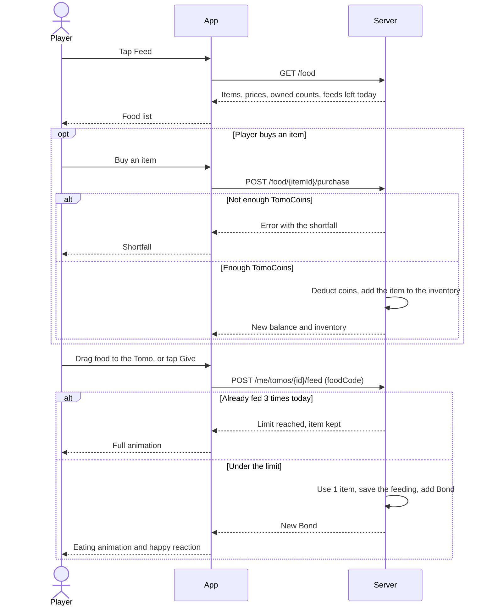

# UC-18: Feed Tomo

| | |
|---|---|
| **Primary Actor** | Player |
| **Priority** | Should |

## Goal

The Player buys a treat and feeds it to their Tomo. This is a light caring moment and a second way to spend TomoCoins.

## Preconditions

- The Player is signed in, online and has an equipped Tomo.

## Trigger

The Player taps **Feed** on the Home Screen.

## Main Flow

1. The System shows the food items, with prices and how many the Player has.
2. The Player picks an item they own, or buys one with TomoCoins.
3. If the Player is buying, the System deducts the cost.
4. The Player drags the food to the Tomo, or taps **Give**.
5. The System plays an eating animation and a happy reaction.
6. The System adds the item's Bond to the Tomo (BR-1).

## Alternate / Exception Flows

- **2a. Not enough TomoCoins:** The System shows the shortfall.
- **6a. The Tomo is at the daily feeding limit:** It plays a "full" animation. The Tomo gets no Bond, and the Player keeps the item.

## Postconditions

- The Player's food stock or TomoCoins decrease, and the Tomo's Bond increases.

## Business Rules

- BR-1: MVP food items *(tunable)*. See [docs/foods](../foods/README.md) for each item's description and art.

  | Item | Cost | Bond |
  |---|---:|---:|
  | Banana | 50 TomoCoins | +3 |
  | Onigiri | 100 TomoCoins | +6 |
  | Bento | 150 TomoCoins | +10 |

- BR-2: The Player can feed each Tomo at most 3 times per day *(tunable)*, so the Player cannot simply trade coins for Bond.
- BR-3: With the values in BR-1 and BR-2, food gives a Tomo at most 30 Bond per day. Moving gives 10 Bond per km with no daily cap ([UC-05](UC-05-calculate-daily-rewards.md) BR-3), so 3 km of moving matches a full day of food. Movement stays the main way to grow.

## Related

- [UC-08 View Home Screen](UC-08-view-home-screen.md)
- [UC-10 Update Tomo Mood](UC-10-update-tomo-mood.md)

## Decisions

- Favorite or disliked foods come later, not in the MVP.
- Feeding does not change the mood ([UC-10](UC-10-update-tomo-mood.md) BR-4).

## Diagrams

### Technical notes

- Food items (code, cost, Bond) are in the server's game data. Stock is `user_food_inventory` and each feeding is a row in `feedings`, both by `food_code`. The daily limit (BR-2) counts `feedings` for the Tomo and the UTC+7 `local_date`.
- Buying adds a `coin_transactions` row with reason `food` and updates `users.coin_balance` in the same transaction. The once-per-source unique index excludes `food`, because a Player can buy the same item many times.
- Using the item, saving the feeding and adding Bond run in one transaction.
- The app waits for the server before playing step 5, so it never shows eating followed by "full".
